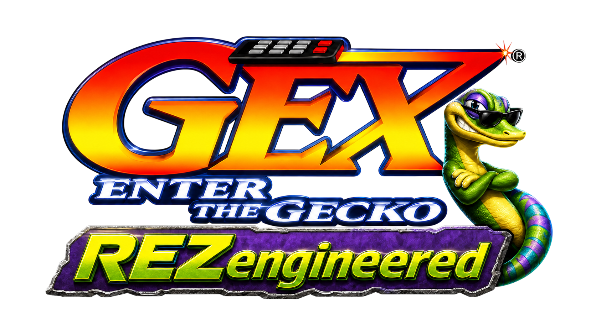
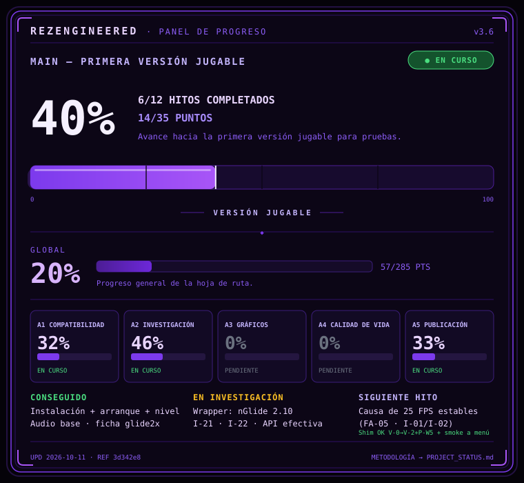

# Gex: Enter the Gecko — REZengineered

[](https://bytematch.dev/mechaivan/gex-enter-the-gecko-rezengineered)

> **English summary:** *Gex: Enter the Gecko* — REZengineered is a
> reverse-engineering, preservation and modernization project for the
> original 1998 PC port.
> Goal: understand how the PC version really works, document every known issue
> and key community fixes with evidence, and only then implement native,
> well-understood fixes — without redistributing proprietary game files.
> Current phase: **1 — Research & Original PC Documentation**.
> Original artifacts inventoried; no game modifications yet.
> In parallel, a native C11 port is being built from the documented
> evidence: SLAG audio reader, ADPCM/streaming path, frame loop, Win32
> window/input/clock, a Direct3D 11 device (R-1), a DXGI swapchain (R-2),
> and a Direct3D 11 renderer with first visible graphics output (R-3) —
> research on VSync, DXGI, Debug Layer and device loss started (R-4).

## Objetivo

1. Comprender cómo funciona realmente la versión original de PC.
2. Analizar su ejecutable, arquitectura, sistemas y dependencias.
3. Investigar los problemas que bloqueen el prototipo y las mejoras prioritarias.
4. Recopilar las soluciones comunitarias existentes y analizar en
   profundidad solo las que informen una implementación concreta.
5. Localizar las causas reales dentro del juego mediante reverse engineering.
6. Desarrollar soluciones propias, priorizando fixes nativos sobre dependencias
   externas cuando sea técnicamente viable.
7. Modernizar el juego preservando su comportamiento y esencia originales.
8. Documentar absolutamente todo para que el proyecto sea reproducible y útil.

## Estado actual

| Campo                 | Valor |
|-----------------------|-------|
| Fase                  | **1 — Research & Original PC Documentation** |
| Versión               | 0.0.0 |
| Artefactos originales | Inventariados (ver `docs/ORIGINAL_ARTIFACT_INVENTORY.md`) |
| Reverse engineering   | **Iniciado** — análisis estático, mapa de funciones, segmentación por subsistemas, traza dinámica del frame y reconstrucción de la ruta de audio. Investigación progresiva en curso. |
| Implementación        | **Iniciada** — port nativo C11 con lector SLAG, audio DirectSound, frame loop, ventana Win32, teclado y reloj real. Renderer Direct3D 11 (R-1/R-2/R-3) con primera salida gráfica visible; R-4 investiga estabilidad y diagnóstico de presentación. El juego todavía no está integrado ni es jugable. |
| Testing               | Hito 1 ejecutado (F-05 + arranque EU en Win11). Componentes del port nativo validados mediante pruebas automatizadas y pruebas reales en Windows. |
| Ruta corta            | Hitos R → K → P + Olas 1–3 (ver `ROADMAP.md`). La vía de implementación nativa avanza en paralelo y no altera el progreso de MAIN. |

Ver [PROJECT_STATE.md](PROJECT_STATE.md) para el estado detallado.

### Panel de progreso



Metodología, evidencias y cifras: [docs/PROJECT_STATUS.md](docs/PROJECT_STATUS.md).

El panel destaca MAIN (primera versión jugable) como hito de investigación y muestra por separado el progreso global de la modernización.

## Principio fundamental

> **Primero entendemos Gex. Después lo reingenierizamos.**

Cada cambio futuro deberá responder:

- ¿Qué problema estamos solucionando?
- ¿Dónde está causado?
- ¿Cómo sabemos que esa es la causa?
- ¿Qué soluciones ya existen?
- ¿Por qué elegimos esta solución?
- ¿Cómo sabemos que no hemos roto otra cosa?

Y todo se clasifica según el modelo de evidencia:
**Confirmado / Inferido / Experimental / Desconocido / Limitación**.
Nunca se presenta una hipótesis como un hecho confirmado.

Los objetivos futuros de modernización (todos propuestos, ninguno
implementado) están en [MODERNIZATION_GOALS.md](MODERNIZATION_GOALS.md).

## Jerarquía de referencias

1. **Fuente de verdad:** el *Gex: Enter the Gecko* original para PC.
2. **Referencias secundarias** (otras versiones: N64, guías PS1…): solo para
   distinguir comportamiento original de la familia Gex de problemas
   específicos del port PC. No reproducir otras versiones.
3. **Gex Trilogy no es referencia** del proyecto (solo contexto histórico).

## Documentación

| Documento                                              | Contenido                                    |
|--------------------------------------------------------|----------------------------------------------|
| [PROJECT_STATE.md](PROJECT_STATE.md)                   | Estado actual del proyecto                   |
| [ROADMAP.md](ROADMAP.md)                               | Fases y plan de trabajo                      |
| [CHANGELOG.md](CHANGELOG.md)                           | Historial de cambios                         |
| [RESEARCH.md](RESEARCH.md)                             | Fuentes y bibliografía anotada               |
| [KNOWN_ISSUES.md](KNOWN_ISSUES.md)                     | Mapa inicial de problemas conocidos          |
| [PATCH_ANALYSIS.md](PATCH_ANALYSIS.md)                 | Catálogo y análisis de fixes existentes      |
| [COMPATIBILITY.md](COMPATIBILITY.md)                   | Matriz de compatibilidad                     |
| [REVERSE_ENGINEERING.md](REVERSE_ENGINEERING.md)       | Plan y metodología de reverse engineering    |
| [docs/ORIGINAL_ARTIFACT_INVENTORY.md](docs/ORIGINAL_ARTIFACT_INVENTORY.md) | Inventario de artefactos originales (Fase 1) |
| [docs/REPO_SYNC_RULE.md](docs/REPO_SYNC_RULE.md)       | Regla permanente de sincronización global    |
| [docs/TOOLKIT.md](docs/TOOLKIT.md)                     | Entorno y herramientas disponibles           |
| [docs/PROJECT_STATUS.md](docs/PROJECT_STATUS.md)       | Metodología y registro del panel de progreso |
| [docs/FUNCTION_MAP.md](docs/FUNCTION_MAP.md)           | Mapa estático de funciones + grafo + imports (EU) |
| [docs/SUBSYSTEM_SEGMENTS.md](docs/SUBSYSTEM_SEGMENTS.md) | Primera segmentación por subsistemas (HYPOTHESIS, EU) |
| [docs/FRAME_STEP_TRACE.md](docs/FRAME_STEP_TRACE.md)   | Traza dinámica del frame step y del update (medida, EU) |
| [docs/AUDIO_INIT_PATHS.md](docs/AUDIO_INIT_PATHS.md)   | Rutas de inicialización de DirectSound (estático, EU) |
| [docs/SAG_CONTAINER.md](docs/SAG_CONTAINER.md)         | Contenedor de audio `SLAG`: formato, lector nativo y pruebas |
| [docs/AUDIO_MIXER_RE.md](docs/AUDIO_MIXER_RE.md)       | Ruta de audio: ADPCM, bomba, reproductor, backend DirectSound (estático + port) |
| [docs/ENGINEERING_LOG_TEMPLATE.md](docs/ENGINEERING_LOG_TEMPLATE.md) | Plantilla del registro de ingeniería |
| [docs/FRAME_LOOP_PORT.md](docs/FRAME_LOOP_PORT.md)     | Frame loop nativo: arquitectura, decisiones de tiempo y pruebas (I-3) |
| [docs/WINDOW_INPUT_PORT.md](docs/WINDOW_INPUT_PORT.md) | Ventana Win32, mensajes, teclado, reloj QPC y renderer nulo (I-4) |
| [docs/RENDERER_ARCHITECTURE_RESEARCH.md](docs/RENDERER_ARCHITECTURE_RESEARCH.md) | Evidencia Glide, comparativa de APIs y plan del renderer nativo (I-5) |
| [docs/D3D11_DEVICE.md](docs/D3D11_DEVICE.md)           | Dispositivo Direct3D 11 real, hardware y WARP (R-1) |
| [docs/D3D11_SWAPCHAIN.md](docs/D3D11_SWAPCHAIN.md)     | Swapchain DXGI sobre la ventana Win32, resize y COM (R-2) |
| [BUILD.md](BUILD.md)                                   | Construcción (port parcial: `port/` funcional) |
| [TESTING.md](TESTING.md)                               | Metodología + protocolo + matriz FA + Hito 1 |
| [MODERNIZATION_GOALS.md](MODERNIZATION_GOALS.md)       | Objetivos futuros (todos PROPOSED)               |
| [CREDITS.md](CREDITS.md)                               | Créditos y agradecimientos                   |
| [LICENSE.md](LICENSE.md)                               | Licencia y política legal                    |

## Estructura del repositorio

```text
/
├── README.md / ROADMAP.md / CHANGELOG.md / ...  # Documentación del proyecto
├── docs/            # Guías (toolkit, plantillas, análisis futuros)
├── analysis/        # Artefactos derivados del binario (mapa de funciones)
├── research/        # Notas de investigación (futuro)
├── tools/           # Herramientas propias (gexmap, glide-shim, m13-core, setup)
├── port/            # Port nativo en C11 (componentes implementados + pruebas)
└── scripts/         # Scripts propios (futuro)
```

`port/` es código nuevo del port: implementación propia escrita a partir de la
evidencia documentada, nunca binario ni assets del juego. Hoy contiene el lector
del contenedor de audio `SLAG`, la ruta de audio completa —decodificador IMA
ADPCM, bomba de streaming y reproductor con backend inyectable—, desde I-2b un
backend DirectSound que hace sonar esa ruta en el dispositivo real más el
planificador que la bombea desde el frame, desde I-3 el frame loop nativo
—acumulador de paso fijo, orden de fases medido y reloj inyectado— y, desde
I-4, el primer proceso ejecutable: ventana Win32 real, teclado, reloj
`QueryPerformanceCounter` y renderer nulo, con `pre_frame` y `update` todavía
como stubs. Sobre esa ventana, R-1 crea el dispositivo Direct3D 11 real y R-2 la
swapchain DXGI con su backbuffer y `ResizeBuffers`; **todavía no se presenta
ningún frame ni se dibuja nada**. **No hay juego ni renderizado.** Ver
[port/README.md](port/README.md), [docs/FRAME_LOOP_PORT.md](docs/FRAME_LOOP_PORT.md),
[docs/WINDOW_INPUT_PORT.md](docs/WINDOW_INPUT_PORT.md),
[docs/D3D11_DEVICE.md](docs/D3D11_DEVICE.md) y
[docs/D3D11_SWAPCHAIN.md](docs/D3D11_SWAPCHAIN.md).

El repositorio contiene **únicamente** código propio, herramientas propias,
documentación y material legalmente distribuible. Los archivos originales del
juego **nunca** se subirán aquí (ver [LICENSE.md](LICENSE.md)).

## Almacenamiento

- **GitHub** → proyecto y fuente de verdad (código, docs, herramientas).
- **Drive** → almacenamiento persistente (originales, backups, dumps, builds).

## Cómo contribuir

De momento el proyecto está en fase de investigación: la mejor contribución es
información verificable (comportamientos observados, hashes, capturas, logs,
análisis de parches). Toda aportación debe indicar su nivel de evidencia.

---

*Proyecto de preservación sin afiliación con Crystal Dynamics, Eidos,
Square Enix, Midway, Ubisoft o Limited Run Games. Gex es marca de sus
respectivos propietarios.*
