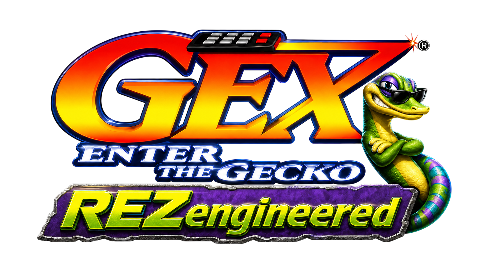
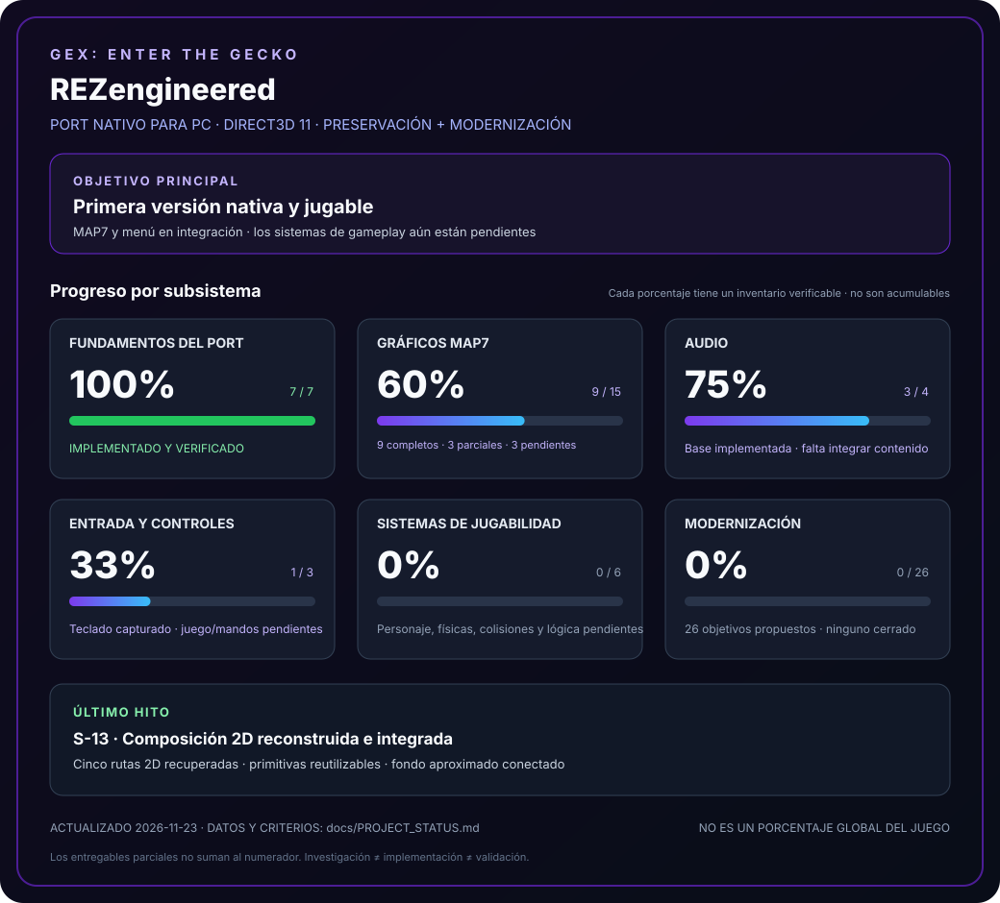

# Gex: Enter the Gecko — REZengineered

[English](README.md) | [Español](README_ES.md)

**A native PC port rebuilt through reverse engineering and Direct3D 11.**

Our goal is to preserve and modernize the original PC version of *Gex: Enter the Gecko* by first understanding how it works and then building a native implementation that retains its original behavior and personality.

This is neither a remake built on an unrelated engine nor a simple modification of the original executable. We are developing our **own native port**, guided by analysis of the PC release and verifiable technical evidence.

> **Current status:** the native foundation is in place, including audio, a window, the main execution loop, and a Direct3D 11 renderer. The menu scene loads and renders real geometry and textures; the original camera sequence and the main menu elements are integrated. The original sky has also been reverse-engineered and is ready for implementation. **The project is not yet playable:** full menu interaction and gameplay systems are still outstanding.

## Project progress

The main progress bar tracks the path to the first playable DX11 build: **10 milestones defined, 1 completed (10%)**. Independent subsystem percentages are shown below it. Partial milestones do not count until they have been verified. See the [progress criteria and breakdown](docs/PROJECT_STATUS.md).

## What are we aiming to achieve?

### 1. Recover the original game

- Understand the PC executable, its formats, subsystems, and behavior.
- Reconstruct level loading, geometry, cameras, materials, audio, and game logic.
- Cross-check findings against the original PC executable and historical PC ports when they provide useful evidence.
- Document discoveries, decisions, limitations, and tests.

### 2. Build a native port

- Replace the legacy graphics path with a modern Direct3D 11 renderer.
- Recreate the original environments, models, textures, effects, and presentation.
- Integrate audio, input, controls, cameras, and gameplay systems.
- Maintain a reusable architecture across different levels.

### 3. Modernize the experience

Once the original game foundation has been recovered, we plan to offer optional improvements without losing the original experience:

| Area | Planned improvements |
|---|---|
| Display | Modern resolutions, 16:9, ultrawide, and camera settings |
| Controls | Modern controllers, button remapping, dead zones, and vibration |
| Options | Accessible configuration and Original / Modern modes |
| Experience | Alt-tab, multi-monitor, DPI, and presentation settings |
| Content | Localization, optional voice support, and skippable intro |
| Graphics | Optional HD resources and configurable visual enhancements |

These are future goals, not features we claim to have implemented. The full catalogue is available in [MODERNIZATION_GOALS.md](MODERNIZATION_GOALS.md).

## Feature status

| Subsystem | Current status |
|---|---|
| Native port foundation | ✓ Implemented and tested |
| Direct3D 11 renderer | ✓ Core renderer and pipeline running on real GPU hardware |
| Menu scene | ◐ Scene, camera, geometry, and textures integrated; original sky reconstruction ready for integration; visual polish remains |
| Main menu | ◐ Scene and buttons visible; navigation and interaction still need implementation |
| Audio | ◐ Base audio path implemented; game content and logic integration remain |
| Input | ◐ Window and keyboard input captured; complete character controls remain |
| Gameplay | ○ Integration pending |
| Modernization | ○ Planned |

**Legend:** ✓ implemented and verified · ◐ partial / in progress · ○ planned or pending · Ⅱ deferred.

## Roadmap

1. **Native foundations** — process, audio, input, execution loop, and renderer.
2. **First scene and menu** — geometry, textures, camera, 2D composition, and menu presentation.
3. **Game integration** — functional menu, character, controls, animations, physics, collisions, objects, and logic.
4. **Content and levels** — reuse common systems and validate each level's specific requirements.
5. **First playable version** — deliver and test a complete playable experience from beginning to end.
6. **Modernization and polish** — options, controllers, resolutions, visual enhancements, and compatibility.

The order may change as reverse engineering reveals new dependencies. We do not announce delivery dates until milestones can be verified.

See the [detailed roadmap](ROADMAP.md) and the [current technical state](PROJECT_STATE.md).

## How we work

- **Evidence first, implementation second.** Hypotheses are clearly identified.
- **Faithful to the original PC release.** Other versions are secondary references, not substitutes for the PC behavior.
- **Test before completion.** Changes are validated with tests and, where appropriate, real execution and GPU output.
- **Continuous documentation.** Technical findings are preserved so the work remains reproducible.
- **Respect for original content.** We do not distribute executables, assets, or other proprietary game files.

## Documentation

| Document | Purpose |
|---|---|
| [PROJECT_STATE.md](PROJECT_STATE.md) | Detailed technical record and current state |
| [Technical documentation index](docs/TECHNICAL_DOCUMENTATION_INDEX.md) | Research reports, phase results, and audits organized by topic |
| [ROADMAP.md](ROADMAP.md) | Project stages and upcoming milestones |
| [PROJECT_STATUS.svg](docs/PROJECT_STATUS.svg) | Visual progress dashboard |
| [PROJECT_STATUS.md](docs/PROJECT_STATUS.md) | Progress criteria, inventories, and percentage calculations |
| [MODERNIZATION_GOALS.md](MODERNIZATION_GOALS.md) | Full catalogue of future improvements |
| [CHANGELOG.md](CHANGELOG.md) | Change history |
| [D3D11_FIRST_SCENE_PLAN.md](docs/D3D11_FIRST_SCENE_PLAN.md) | First-scene research and implementation |
| [port/README.md](port/README.md) | Native port architecture and components |
| [BUILD.md](BUILD.md) · [TESTING.md](TESTING.md) | Build and testing instructions |
| [LICENSE.md](LICENSE.md) | License and distribution limitations |

## Repository and project content

Research reports and phase results are organized under `docs/reports/`, while audits are kept under `docs/audits/`. See the [technical documentation index](docs/TECHNICAL_DOCUMENTATION_INDEX.md).

The repository contains original code, custom tools, and documentation. Original game files and other proprietary materials are not published here. See [LICENSE.md](LICENSE.md).

---

*Independent preservation and development project. Not affiliated with Crystal Dynamics, Eidos, Square Enix, Midway, Ubisoft, or Limited Run Games. Gex is a trademark of its respective owners.*
