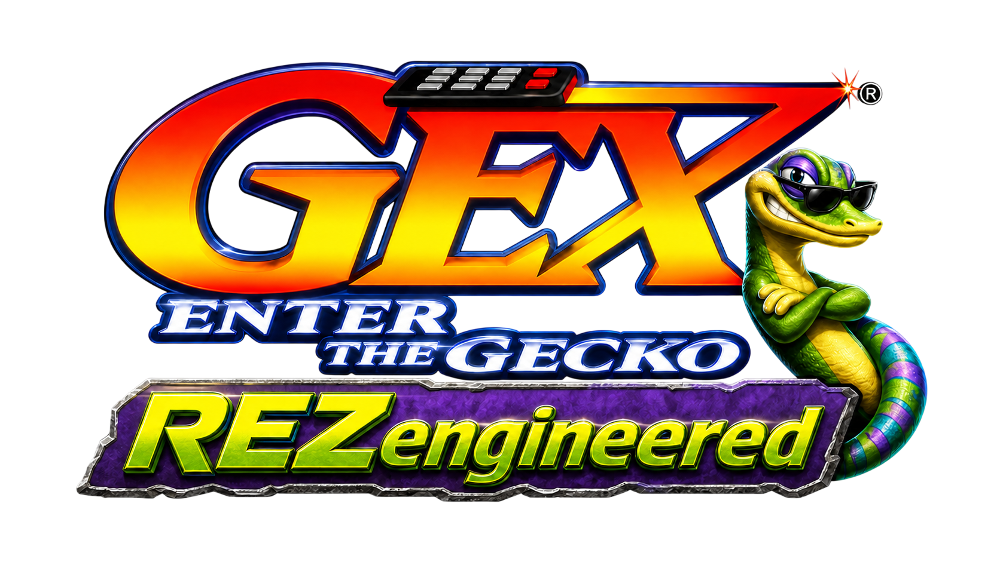
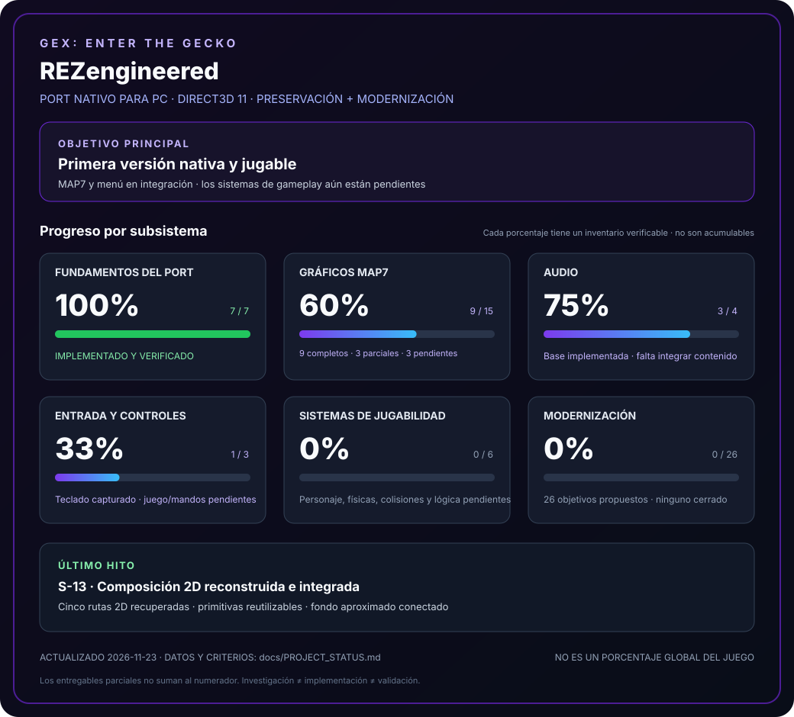

# Gex: Enter the Gecko — REZengineered

[English](README.md) | [Español](README_ES.md)

**Un port nativo para PC, reconstruido mediante ingeniería inversa y Direct3D 11.**

Nuestro objetivo es preservar y modernizar la versión original de *Gex: Enter the Gecko* para PC. Primero queremos comprender cómo funciona y después construir una implementación nativa que conserve su comportamiento y personalidad originales.

No es un remake creado sobre un motor ajeno ni una simple modificación del ejecutable original. Estamos desarrollando **nuestro propio port nativo**, guiado por el análisis de la versión de PC y por evidencias técnicas verificables.

> **Estado actual:** la base nativa ya está implementada, incluyendo audio, ventana, bucle principal de ejecución y renderer Direct3D 11. La escena del menú carga y dibuja geometría y texturas reales; la secuencia de cámara original y los elementos principales del menú están integrados. También hemos reconstruido mediante ingeniería inversa el cielo original, listo para su implementación. **El proyecto todavía no es jugable:** faltan la interacción completa del menú y los sistemas de gameplay.

## Progreso del proyecto

La barra principal muestra el camino hacia la primera build jugable DX11: **10 hitos definidos, 1 completado (10%)**. Debajo aparecen los porcentajes independientes de cada subsistema. Los hitos parciales no cuentan hasta que están verificados. Consulta los [criterios y el desglose del progreso](docs/PROJECT_STATUS.md).

## ¿Qué queremos conseguir?

### 1. Recuperar el juego original

- Comprender el ejecutable de PC, sus formatos, subsistemas y comportamiento.
- Reconstruir la carga de niveles, geometría, cámaras, materiales, audio y lógica.
- Contrastar los hallazgos con el ejecutable original y con ports históricos de PC cuando aporten evidencias útiles.
- Documentar descubrimientos, decisiones, limitaciones y pruebas.

### 2. Construir un port nativo

- Sustituir la ruta gráfica heredada por un renderer moderno basado en Direct3D 11.
- Recrear los escenarios, modelos, texturas, efectos y presentación originales.
- Integrar audio, entrada, controles, cámaras y sistemas de juego.
- Mantener una arquitectura reutilizable para los distintos niveles.

### 3. Modernizar la experiencia

Una vez recuperada la base original del juego, queremos ofrecer mejoras opcionales sin perder la experiencia clásica:

| Área | Mejoras previstas |
|---|---|
| Pantalla | Resoluciones modernas, 16:9, ultrawide y ajustes de cámara |
| Controles | Mandos actuales, reasignación de botones, zonas muertas y vibración |
| Opciones | Configuración accesible y modos Original / Modern |
| Experiencia | Alt-tab, multimonitor, DPI y ajustes de presentación |
| Contenido | Localización, voces opcionales e introducción que se pueda omitir |
| Gráficos | Recursos HD opcionales y mejoras visuales configurables |

Estas mejoras son objetivos futuros, no funciones que afirmemos tener ya implementadas. El catálogo completo está en [MODERNIZATION_GOALS.md](MODERNIZATION_GOALS.md).

## Estado de las funcionalidades

| Subsistema | Estado actual |
|---|---|
| Fundamentos del port nativo | ✓ Implementados y probados |
| Renderer Direct3D 11 | ✓ Base y pipeline funcionando en GPU real |
| Escena del menú | ◐ Escena, cámara, geometría y texturas integradas; reconstrucción del cielo original lista para integrar; queda pulido visual |
| Menú principal | ◐ Escena y botones visibles; falta implementar navegación e interacción |
| Audio | ◐ Ruta base implementada; falta integrarla con el contenido y la lógica del juego |
| Entrada | ◐ Ventana y teclado capturados; falta el control completo del personaje |
| Jugabilidad | ○ Pendiente de integración |
| Modernización | ○ Planificada |

**Leyenda:** ✓ implementado y verificado · ◐ parcial/en desarrollo · ○ planificado o pendiente · Ⅱ aplazado.

## Hoja de ruta

1. **Fundamentos nativos** — proceso, audio, entrada, bucle de ejecución y renderer.
2. **Primer escenario y menú** — geometría, texturas, cámara, composición 2D y presentación del menú.
3. **Integración del juego** — menú funcional, personaje, controles, animaciones, físicas, colisiones, objetos y lógica.
4. **Contenido y niveles** — reutilizar los sistemas comunes y validar las particularidades de cada nivel.
5. **Primera versión jugable** — completar una experiencia jugable de principio a fin y someterla a pruebas.
6. **Modernización y pulido** — opciones, mandos, resoluciones, mejoras visuales y compatibilidad.

El orden puede cambiar si la ingeniería inversa descubre nuevas dependencias. No anunciamos fechas hasta disponer de hitos verificables.

Consulta la [hoja de ruta detallada](ROADMAP.md) y el [estado técnico actual](PROJECT_STATE.md).

## Cómo trabajamos

- **Primero evidencia, después implementación.** Las hipótesis se identifican claramente.
- **Fidelidad a la versión original de PC.** Otras versiones son referencias secundarias, no sustitutos del comportamiento de PC.
- **Pruebas antes de cerrar.** Los cambios se validan con tests y, cuando corresponde, ejecución real y GPU.
- **Documentación continua.** Conservamos los hallazgos técnicos para que el trabajo sea reproducible.
- **Respeto por el contenido original.** No distribuimos ejecutables, assets ni otros archivos propietarios del juego.

## Documentación

| Documento | Para qué sirve |
|---|---|
| [PROJECT_STATE.md](PROJECT_STATE.md) | Registro técnico detallado y estado actual |
| [Índice de documentación técnica](docs/TECHNICAL_DOCUMENTATION_INDEX.md) | Informes de investigación, resultados de fases y auditorías organizados por tema |
| [ROADMAP.md](ROADMAP.md) | Etapas del proyecto y próximos hitos |
| [PROJECT_STATUS.svg](docs/PROJECT_STATUS.svg) | Panel visual de progreso |
| [PROJECT_STATUS.md](docs/PROJECT_STATUS.md) | Criterios, inventarios y cálculo de porcentajes |
| [MODERNIZATION_GOALS.md](MODERNIZATION_GOALS.md) | Catálogo completo de mejoras futuras |
| [CHANGELOG.md](CHANGELOG.md) | Historial de cambios |
| [D3D11_FIRST_SCENE_PLAN.md](docs/D3D11_FIRST_SCENE_PLAN.md) | Investigación e implementación del primer escenario |
| [port/README.md](port/README.md) | Arquitectura y componentes del port nativo |
| [BUILD.md](BUILD.md) · [TESTING.md](TESTING.md) | Compilación y pruebas |
| [LICENSE.md](LICENSE.md) | Licencia y límites de distribución |

## Repositorio y contenido

Los informes de investigación y resultados de fases se organizan bajo `docs/reports/` y las auditorías bajo `docs/audits/`; consulta el [índice de documentación técnica](docs/TECHNICAL_DOCUMENTATION_INDEX.md).

El repositorio contiene código nuevo, herramientas propias y documentación. Los archivos originales del juego y otros materiales propietarios no se publican aquí. Consulta [LICENSE.md](LICENSE.md).

---

*Proyecto independiente de preservación y desarrollo, sin afiliación con Crystal Dynamics, Eidos, Square Enix, Midway, Ubisoft o Limited Run Games. Gex es marca de sus respectivos propietarios.*
